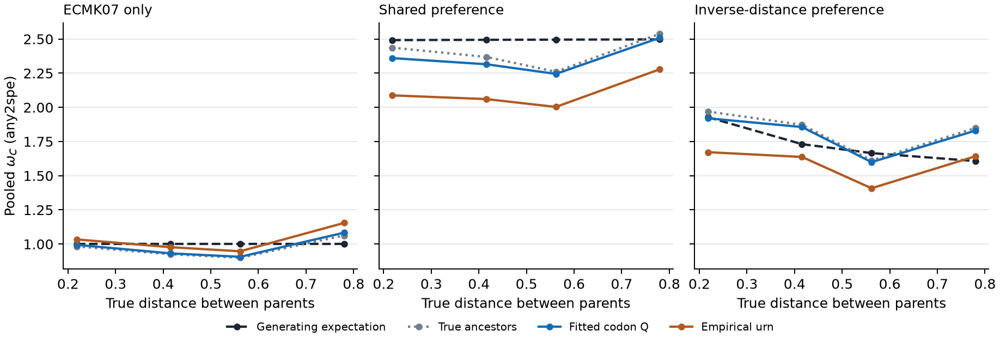

# Recovery of inverse-distance convergence on a PEPC tree

We simulated 1,200 codon sites on the PEPC topology with 71 tips. The
background is ECMK07 with the bundled PEPC equilibrium frequencies.
Twenty-four tips selected at fixed intervals in tree order have terminal
branch lengths of 0.08, so the focal branch lengths are identical. The
276 focal tip pairs differ in the path length (d) between their
parents. Their four equal-size distance bins have mean distances of
0.218, 0.416, 0.562, and 0.780 expected background substitutions per codon.

## Model and controls

Half the sites have a simulated background state that determines a
preferred amino acid on the focal terminal edges. On these edges, the
instantaneous N rates toward that amino acid are multiplied by eight.
Other instantaneous rates are retained, including S. The other half of
the sites and all other edges use the background generator. Each
site's preferred state has a uniform marginal distribution over the
20 amino acids. The preferred state is known at the parent and held
fixed along the focal edge.

The neutral control uses ECMK07 on all edges. The shared-preference
control assigns the same preferred state to all focal edges at a site.
The inverse-distance treatment evolves the preferred state by a
random-reset process along the tree. If its rate at a site is
\(\lambda\), two parent states have a probability \(\exp(-\lambda d)\)
of sharing the ancestral preference through that path. Drawing
\(\lambda\) independently per site from an exponential distribution with
mean \(1/0.18\) makes the average retention
\(w(d) = 1/(1 + d/0.18)\). The overall probability of a matching
preference is \(1/20 + (19/20)w(d)\). The two selected treatments have
identical marginal distributions of preferred states and terminal-edge
substitution rates.

We compute generating counts by integrating the joint parent codon
distribution, the probabilities of the two preference states, and the
two terminal endpoint kernels. The null counts use the background Q on the
two terminal edges. All counts are net endpoint changes. The comparison
also scores realized changes from the simulated true ancestors.

## Fitting and distance scores

Each of 18 seeds is used in all three conditions. Fit `ECMK07+F` on the
known topology using the simulated tip alignment and estimate branch
lengths. Both CSUBST searches reuse that fit and use the same observed
joint-endpoint counts. The urn search uses the default cross-fitted
empirical site and route estimator. The simulator's focal branches are
used to summarize the results after the searches. The primary analysis
bins pairs by the true distance between parents. A secondary analysis
bins pairs by the historical fitted `dist_bl` reported by `search`.
With the parent-distance definition, the reproduction script reads that
historical statistic from `dist_bl_legacy`.

Within each bin, pool N and S counts before computing `omegaCany2spe`.
The near/far ratio is the first bin's pooled omegaC divided by that of
the fourth bin. To measure recovery of the modulation relative to the
shared-preference control, compute the difference in log near/far ratio
between the inverse and shared treatments within each seed. For
descriptive 95% percentile intervals of the mean contrast, resample
whole seeds with replacement 20,000 times using RNG seed 226513.

## Results

The table gives the pooled near/far ratio for each condition, using
true distances. A value of one means equal pooled omegaC at the two
ends of the distance range.

| Condition | Generating expectation | True ancestors | Fitted codon Q | Empirical urn |
| --- | ---: | ---: | ---: | ---: |
| Neutral ECMK07 | 1.000 | 0.925 | 0.918 | 0.895 |
| Shared preference | 0.998 | 0.960 | 0.941 | 0.916 |
| Inverse-distance preference | 1.200 | 1.065 | 1.049 | 1.018 |

Under inverse-distance preference, generating omegaC falls from 1.928
to 1.607. The matching-preference probability falls from 0.507 to 0.230.
The realized ratios vary substantially with distance in each seed. With
the true distance, the near bin has a higher omegaC than the far bin in
10 of 18 seeds with true ancestors and 9 of 18 with each fitted method.

| Mean within-seed log contrast, inverse minus shared | True distances | Fitted `dist_bl` |
| --- | ---: | ---: |
| Generating expectation | 0.184 | 0.184 |
| True ancestors | 0.115 [0.011, 0.223] | 0.142 [0.024, 0.267] |
| Fitted codon Q | 0.121 [0.016, 0.225] | 0.147 [0.027, 0.268] |
| Empirical urn | 0.116 [0.015, 0.219] | 0.142 [0.026, 0.262] |
| Empirical urn minus fitted codon Q | −0.005 [−0.015, 0.005] | −0.005 [−0.015, 0.005] |

For true distances, the paired contrast is positive in 12 of 18 seeds
for both fitted methods. Using the inferred O counts with the simulated
Q null counts gives a mean contrast of 0.121. The corresponding contrast
from realized changes and the same Q null is 0.115. On these simulations,
the variation in realized counts is large compared with the differences
caused by estimated ancestors and the two EC methods. The urn puts
omegaC below the codon estimate across all four bins under either
selection treatment, while recovering a similar distance contrast. The
experiment uses one tree and one strength of inverse-distance coupling;
it measures sensitivity to the specified signal.



[Counts by seed, method, and distance bin](epistasis_distance_summary.tsv)

## Reproduction

Editable CSUBST 1.17.5 based on `c39484a` with the empirical urn change,
Python 3.12.15, macOS arm64, and IQ-TREE 3.1.4. From the repository root:

```bash
work="$(mktemp -d)"
export MPLBACKEND=Agg VECLIB_MAXIMUM_THREADS=1 OPENBLAS_NUM_THREADS=1 OMP_NUM_THREADS=1
python reports/omega_low_count_20261116/epistasis_distance.py \
  "$work" --iqtree "$IQTREE_EXE" --jobs 8
```
