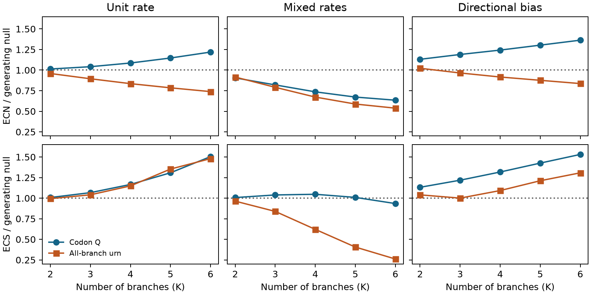

# High-arity PEPC: all-branch empirical urn versus fitted codon Q

Both methods recover the same 20 quadruples, six quintuples and one
sextuple in the natural PEPC search. This agreement does not extend to
the calibration of the expected counts. In simulated mixed-rate PEPC
the urn's pooled synonymous expectation drops to 26% of the generating
null at K=6, compared with 93% for fitted Q. Under a directional bias,
however, the urn's pooled N and S expectations are closer to the
generating null than fitted Q's. Raw high-arity omega is very poorly
supported by the event counts in the nine simulated alignments.

## Natural PEPC: blind candidate search

The bundled 71-tip, 971-codon alignment, rooted tree and ECMK07+F+R4 fit
are identical in both runs. No foreground is supplied. Ordinary
candidate expansion starts with all independent non-sister pairs,
allows K up to 10, and requires OCNany2spe >= 2 and omegaCany2spe >= 5.
The table lists evaluated / retained combinations and the number of hits
shared by both methods. Every shared row agreed on OCN and OCS within
numerical precision. No IQ-TREE refit is included.

| K | Fitted codon Q | empirical_all | Shared retained |
|---:|---:|---:|---:|
| 2 | 8,446 / 85 | 8,446 / 250 | 85 |
| 3 | 416 / 45 | 2,046 / 63 | 45 |
| 4 | 87 / 20 | 121 / 20 | 20 |
| 5 | 14 / 6 | 14 / 6 | 6 |
| 6 | 1 / 1 | 1 / 1 | 1 |

The sole K=6 hit is `1,26,33,35,40,102`. OCN = 2.498897 and OCS = 0
at 17 decimal places, yielding infinite raw omegaC for both methods.
Fitted Q gives ECN = 9.535e-9 and ECS = 1.551e-6; the urn gives
ECN = 1.138e-8 and ECS = 1.360e-7. Of the extra 18 urn triples, two
consist entirely of the nine annotated C4 stems; annotation is not a
molecular ground truth. See [site contributions](PEPC_HIGHER_ORDER.md).

End-to-end wall-time medians (three serial measurements per method after
one warmup per method; alternating order, one CSUBST/BLAS thread) were
5.20 s for fitted Q and 6.21 s for the urn; ranges 5.17–5.25 s and
6.10–6.25 s. Median peak RSS was 725 and 549 MiB, respectively.
The two searches visit different numbers of candidates. These figures
describe the entire default search rather than per-combination kernel
speed. Each method reproduced its own candidate IDs, OC, EC and omega
across the four runs. [Measurements](pepc_high_arity_timing.tsv)

## Fixed-combination accuracy under a known generating model

Use the nine [existing ECMK07 simulations](EMPIRICAL_URN_ECMK07.md)
(520 codons; seeds 741, 852 and 963 per condition) and their saved IQ-TREE
fits. Unlike the previous background table of all eligible pairs,
**all three conditions here use exactly the same nine prespecified C4
stem branches**. Score every independent K-subset from K=2 through 6:
36, 84, 126, 126 and 84 combinations per seed. Sister pairs are allowed
as in the simulation panel. The foreground specification selects rows
to score; urn training still uses all 138 eligible branches. Fitted Q
and urn use the same branch lengths, rates, generator and observed counts
for a given ASR fit. The no-bias scenarios have unit rates or four
equal-weight rates (0, 0.2, 0.8, 3). Under directional bias the nine
stems share a preferred amino acid at 20% of unit-rate sites.

The reference integrates same-destination endpoint events over the joint
distribution of ancestral codons at splits, rather than multiplying
unconditional branch marginals. It uses the simulator's actual partition
Q, site rate, root distribution and branch lengths. The signal expectation
uses the generating Q on every edge; the null replaces Q only on the
evaluated edges with the background Q. Replay reproduced all nine saved
tip and ancestral alignments and the released pairwise oracle on all
36 stem pairs per replicate. On a separate six-tip toy tree a direct
sum over ancestral codon assignments agreed for all K=2 through 6.

Each cell below gives summed **ECN / null N, ECS / null S** (target 1, 1).
The ASR fit is ECMK07_GY0K+F (+R4 for the mixture); the pooled TSV also
gives the matched ECMK07+F fits.

| K | Unit, fitted Q | Unit, urn | Mixed, fitted Q | Mixed, urn | Biased, fitted Q | Biased, urn |
|---:|---:|---:|---:|---:|---:|---:|
| 3 | 1.041, 1.067 | 0.895, 1.041 | 0.820, 1.039 | 0.791, 0.839 | 1.190, 1.218 | 0.965, 1.001 |
| 4 | 1.086, 1.166 | 0.836, 1.149 | 0.736, 1.047 | 0.672, 0.621 | 1.243, 1.318 | 0.916, 1.092 |
| 5 | 1.147, 1.308 | 0.785, 1.353 | 0.673, 1.009 | 0.588, 0.406 | 1.303, 1.426 | 0.876, 1.211 |
| 6 | 1.219, 1.504 | 0.739, 1.480 | 0.635, 0.934 | 0.538, 0.261 | 1.363, 1.531 | 0.836, 1.308 |



Even when the urn's **sum** is closer, its errors on individual combinations
can be larger. For K=6 under directionality, the sum of absolute ECS errors
divided by summed true null S is 1.83 for the urn vs 0.58 for fitted Q.
For ECN under the same condition this error is smaller for the urn
(0.31 vs 0.52). These are descriptive results for one topology, nine
chosen branches and three seeds, not independent replicates per combination.

## Is raw omega supported? Can blind search find the implanted pattern?

In the biased condition, the ratio of summed **generating means** is
32.07 at K=3; the ratio from inferred pooled counts is 7.40 for Q vs
7.49 for the urn. The true simulated ancestors contain only one N and
two S triple events when summed over all 252 combination-replicates.
At K=4–6 the true ancestors contain **no** qualifying N or S events in
any of the three scenarios. Nonzero posterior endpoint masses may still
generate numerical ratios. In particular, at biased K=6 the generating
mean is only 0.00269 N and 0.0000151 S summed over the 252 rows, despite
a generating omega of about 58,586. Ratios from near-zero, rounded output
are not reliable estimates. An RMSE restricted to finite omega also
includes zeros assigned by the raw estimator and omits infinities.

With the default cutoffs, **blind** scans (hybrid fit) had no passing
K>=3 hits in any of the nine simulations for either estimator. In the
biased condition neither recovered any wholly implanted K>=3 combination.
Even scoring the nine stems directly, the maximum triple OCN in the biased
panel was 0.868: changing the denominator cannot clear the OCN >= 2
threshold. In the null conditions neither estimator returned any K>=3
hit, but three seeds per condition cannot calibrate false positive rates.

[Per-seed counts](pepc_high_arity_by_seed.tsv) · [Pooled scores, including both ASR fits](pepc_high_arity_pooled.tsv) · [Blind search counts](pepc_high_arity_blind.tsv)

## Reproduction

CSUBST 1.17.5 working tree based on b782efd (with empirical_all),
macOS 27.0.1 arm64, Python 3.12.15, archived IQ-TREE 3.1.4 fits.
From the repository root in the editable environment, set PANEL to the
work directory prepared by the `--stage fit` command in the
[ECMK07 study](EMPIRICAL_URN_ECMK07.md). The oracle is a research
adapter; the public simulator's pairwise output is unchanged.

```bash
work=$(mktemp -d)
mkdir "$work/inputs"
cp csubst/dataset/PEPC.alignment.fa* csubst/dataset/PEPC.tree.nwk "$work/inputs/"
script=reports/omega_low_count_20261116/pepc_high_arity_accuracy.py
export MPLBACKEND=Agg OPENBLAS_NUM_THREADS=1 OMP_NUM_THREADS=1 VECLIB_MAXIMUM_THREADS=1
python "$script" real "$work/real" "$work/inputs"
python "$script" "$PANEL" "$work/sims" --jobs 4
```

The real timing command uses macOS `/usr/bin/time -l`. To rescore a completed
simulation directory without rerunning the searches, use the script's
`score "$work/sims"` subcommand.
