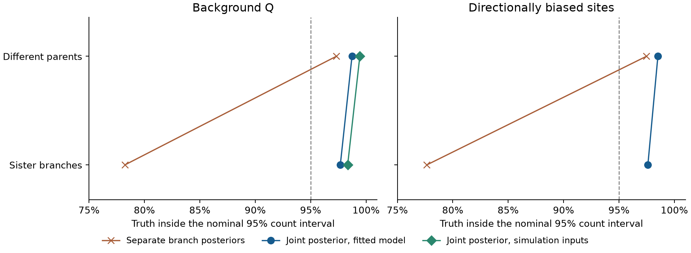

# Joint branch-pair posteriors for realized convergence counts

We evaluated the coverage of central 95% posterior intervals for realized
N and S convergence counts on **2,558 pair-replicates from 40 PGK and PEPC
alignments**. The same fitted model gives better S counts and intervals
when the calculation conditions both branches on the same ancestral state.
Integrating only the shared site-rate category produces little change.
The largest gain is for sister branches, which the default search excludes.
The [runtime benchmark](PERFORMANCE.md) measures the cost of applying the
exact branch-pair estimator to the pairs eligible in default `search`.



## Comparison

The [sensitivity panel](../simulate_sensitivity_20261116/README.md) supplied
25 background-Q alignments with uniform or mixed site rates and another
15 alignments with directional bias at 20% of sites. We used saved
IQ-TREE 3.1.4 fits, including the
[accepted refits](../simulate_sensitivity_20261116/RECOVERY.md) for the
stalled multipliers. The prototype uses CSUBST 1.17.5 at `c9f5d89`,
Python 3.12.15, and macOS arm64. It is implemented as a report script.

Within each alignment condition, we selected up to eight pairs in each
combination of Q-based expected S-count bin and sister status with a fixed
seed. Identical pairs were assessed across the replicates. The biased
panel also includes every eligible pair of two foreground branches.
The sample deliberately includes sisters and pairs with high expected S
counts. Reported rates describe this sample. Rows that share branches or
alignments are dependent.

| Method | Conditioning used for an event on both branches |
| --- | --- |
| Separate branch posteriors | Multiply the marginal event probabilities, as in current search |
| Shared rate | Multiply branch probabilities conditional on the same site-rate category |
| Joint posterior, fitted model | Integrate over one state at the pair's common ancestor and one site-rate category |
| Joint posterior, simulation inputs | Use the generating Q, branch lengths, and realized per-site rates for the background-Q panel |

For the joint calculation, downward transition kernels are conditional on
the tip alignment. For each branch, we propagate a probability for each
derived state back to the pair's last common ancestor. The branches are
conditionally independent within separate child subtrees after fixing that
ancestor's state and the site-rate category. Summing over their joint
posterior gives exact per-site N and S probabilities for the fixed model.
The construction integrates endpoint states. Posterior CTMC path
sampling would additionally include changes within a branch.
[Nielsen 2002](https://academic.oup.com/sysbio/article-abstract/51/5/729/1678456)

N, S, and neither are mutually exclusive for a given pair and site.
A bivariate recurrence gives the posterior distribution of the two
integer counts across independent sites. The retained count grid excludes
at most 2 × 10⁻¹² posterior mass. We retain the distinction between an
undefined ratio when N = S = 0, an infinite ratio when N > 0 and S = 0,
and the finite outcomes. Equal-tailed ratio intervals are conditional on
the ratio being defined. They use the Q-based null denominators to isolate
endpoint-count uncertainty.

The prototype matched exhaustive enumeration on a small tree, including
sisters, more distant pairs and an invariant category. For every tested
real pair, the factorized replay matched both production O counts within
5.03 × 10⁻¹³. The simulation-input calculator reproduced Q-based counts
within 1.69 × 10⁻¹⁴ before conditioning on tips. For the 2.5× branch
scaling condition, the exported true-ASR tree rounds the scaled lengths
in Newick serialization. The simulation-input replay therefore scales
the original lengths in memory.

## Results

S coverage is the fraction of known realized synonymous counts inside the
central interval. The column for simulation inputs is reported for the
background-Q panel, where every branch uses the same generator.

| Simulations | Relationship | Rows | Separate branches | Shared rate only | Joint, fitted | Joint, simulation inputs |
| --- | --- | ---: | ---: | ---: | ---: | ---: |
| Background Q | Different parents | 708 | 97.3% | 97.3% | 98.7% | 99.4% |
| Background Q | Sisters | 602 | 78.2% | 78.2% | 97.7% | 98.3% |
| Directional bias | Different parents | 872 | 97.5% | 97.5% | 98.5% | NA |
| Directional bias | Sisters | 376 | 77.7% | 77.7% | 97.6% | NA |

S coverage increased in 24 of the 25 background-Q alignments and all 15
biased alignments, with one background replicate tied. Synonymous posterior
mean RMSE fell from **1.83 to 1.07** counts in the background panel and from
**1.65 to 0.95** in the biased panel. For differently parented pairs,
background S RMSE fell from 0.85 to 0.76, and biased S RMSE from 0.86 to
0.72. The directional-bias foreground subset already had high coverage
under separate branches. Its S coverage stayed at 98.6% across 444 rows.

A PGK sister pair in the long-branch condition had 17 actual synonymous
convergences at seed 101. The means were 5.72 under the separate-branch
calculation and 19.43 under the joint fitted calculation. A state change on
both sister branches can depend on the same uncertain parent. Treating
the branches independently can count two copies of that uncertainty.

Integer count intervals usually contain more than 95% model probability
because of discreteness. The central 95% of randomized posterior S ranks
contained 83.3% of the realized background observations under separate
branches, 92.7% under the joint fitted calculation, and 94.2% with the
simulation inputs. These are descriptive calibration checks on 25
alignments. They leave room for further error from the fitted model.

Across both panels, every one of the **1,368** samples with both true counts
zero had a finite point estimate from search. For the background-Q rows
with expected S at or below 0.1, the joint fitted posterior assigned
96.7% mean probability to an undefined ratio. Among rows with a defined
true ratio, its conditional numeric interval covered 602/607 in the
background panel and 580/583 in the biased panel. These intervals
reconstruct a realized count ratio conditional on fixed model parameters.
Inference for the expected omegaC parameter also requires accounting for
sampling of sites and uncertainty in Q, branch lengths and the rate model.

The clearest diagnostic for low-support pairs is the posterior mass on the
undefined ratio, alongside the integer N and S count intervals. The large
sister-branch effect and smaller change for differently parented pairs help
define which cases to prioritize in a search implementation.

## Reproduce

The `panel` and `recovered` directories have the layout of the
[sensitivity](../simulate_sensitivity_20261116/README.md) and
[recovery](../simulate_sensitivity_20261116/RECOVERY.md) runs. Use the same
Python environment and run from the repository root.

```bash
scripts=reports/omega_low_count_20261116
out=reports/generated/omega_low_count/posterior
export MPLBACKEND=Agg VECLIB_MAXIMUM_THREADS=1 OPENBLAS_NUM_THREADS=1 OMP_NUM_THREADS=1
python "$scripts/verify_posterior.py"
python "$scripts/replay_posterior.py" "$panel" "$recovered" "$out/null/pairs.tsv"
python "$scripts/replay_posterior.py" "$panel" "$recovered" "$out/biased/pairs.tsv" --biased
python "$scripts/summarize_posterior.py" "$out/null/pairs.tsv" "$out/null"
python "$scripts/summarize_posterior.py" "$out/biased/pairs.tsv" "$out/biased"
python "$scripts/plot_posterior.py" "$out" "$out/posterior_coverage.png"
```

- [Background-Q pair-level results](posterior/null/pairs.tsv.gz) and
  [summaries by relationship](posterior/null/posterior_by_relationship.tsv).
- [Directional-bias pair-level results](posterior/biased/pairs.tsv.gz) and
  [summaries by relationship](posterior/biased/posterior_by_relationship.tsv).
- [Background-Q support bins](posterior/null/posterior_by_support.tsv) and
  [directional-bias foreground counts](posterior/biased/posterior_by_foreground.tsv).
