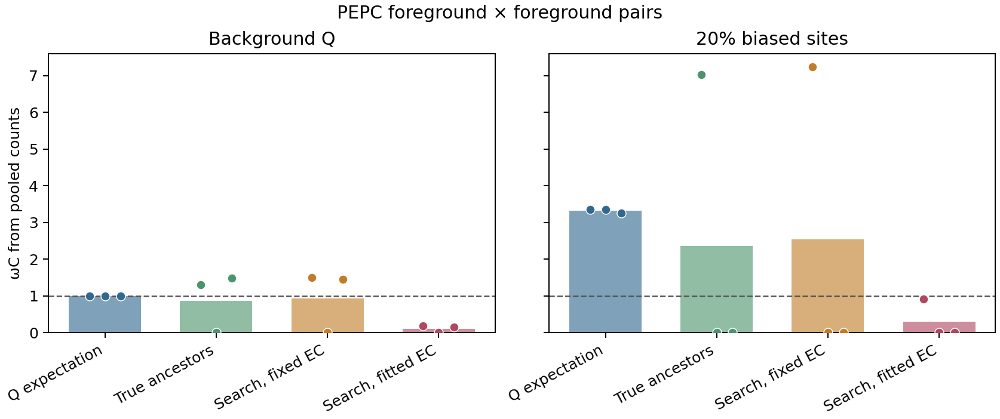

# PEPC simulation check for expected omegaCany2spe

We compared the Q-based expected ratio from `simulate`, the realized ratio
from the simulated ancestral and tip codons, and the default joint-endpoint
estimates from `search`. The simulations use the bundled PEPC tree, alignment,
foreground stems, and IQ-TREE model parameters. Each of two conditions used
1,000 codon sites and seeds 101, 202 and 303. In the biased condition, 20% of
sites had a random preferred amino acid on foreground branches with
`--percent_biased_sub 90`. Both conditions used background and foreground
omega settings of 0.2, the original tree lengths, and a uniform site rate.
In the background condition all sites used the background Q. CSUBST 1.17.5
at base revision `ed229ac` with this change, Python 3.14.7, and IQ-TREE 3.1.4
ran on macOS arm64. Search refitted ECMK07+F+R4 to each simulated tip
alignment on the same topology.

The simulation audit found that Pyvolve inherited the foreground Q below
untagged descendants of foreground stems. PEPC has two such internal stems.
The revised runs explicitly assign the background Q to those descendants.
The old biased seed 101 had 705 pairs of unannotated branches with a
non-background N expectation. After the fix the expected omegaC is 1 for
every pair of unannotated branches in the three biased replicates.

All six searches completed. Each result matched all 8,516 simulation pairs
one to one by branch IDs, including 36 pairs of two foreground stems.
The pooled values below sum the relevant N and S counts and their
denominators over those 36 pairs and all three replicates before taking the
ratio. True ancestors and search with fixed EC use the same Q-based null
denominator. Search with fitted EC uses sums of the EC columns from search.

| Condition | Q expectation | True ancestors | Search, fixed EC | Search, fitted EC |
| --- | ---: | ---: | ---: | ---: |
| Background Q | 1.00 | 0.86 | 0.93 | 0.10 |
| 20% biased sites | 3.32 | 2.36 | 2.53 | 0.30 |



Across the 108 foreground pair-replicates in the biased condition, the Q
expectation had a median of 3.35. The model predicted 7.27 N and 110.89 S
convergences in total. The realized counts were 5 and 107. Search estimated
5.00 and 99.74. Only four pair-replicates, all from seed 101, had any true
N convergence. Their search estimates were within 0.003 of the true N
count. In 52 pair-replicates, both true counts were zero and the realized
ratio was undefined. For the four positive ratios, the median absolute
log10 error of truth against the Q expectation was 0.75. The estimate from
search with fitted EC was zero in 25 of the 108 rows. Among its 83 positive
rows the median absolute log10 error was 5.15. These errors are conditional
on a positive finite ratio and have different row counts.

The pooled biased estimate fell from 2.53 with fixed EC to 0.30 with fitted
EC. Across those same rows, the fitted expectations totaled 9.49 N and 56.13
S, versus 2.19 N and 110.81 S under the simulation null. This accounts for
the drop when using the fitted denominator. The fitted workflow still ranked
the biased condition above the background condition by the pooled ratio.
The single PEPC tree, short alignments, and four positive foreground rows
limit the precision of pair-level recovery estimates.

- [Pair results](paired_results.tsv.gz) contain all 51,096 matched rows with
  branch IDs, foreground flags, and all four ratio columns.
- [Count summary](count_summary.tsv) and [counts by seed](count_by_seed.tsv)
  show totals and mean absolute errors for N and S.
- [Ratio summary](omega_summary.tsv) and [ratios by seed](omega_by_seed.tsv)
  include zeros, infinities, unavailable ratios, and log errors for positive
  finite comparisons.
- [Software benchmark](PERFORMANCE.md) measures simulation time, memory and
  numerical parity before and after the audit.
- [ECN and ECS decomposition](EC_DECOMPOSITION.md) separates the effects of
  Q, branch lengths and site rates.
- [Codon-model refits](CODON_MODEL_REFIT.md) test estimating the ECMK07
  nonsynonymous multiplier from the same simulated tips.

## Reproduce

Run from the CSUBST repository root with an editable installation and IQ-TREE
3.1.4 on PATH, or set `IQTREE_EXE` to its absolute path. Intermediate files
stay in a new temporary directory. Each simulation reuses the copied bundled
fit and each search re-estimates the model from its own simulated tips.

```bash
repo="$PWD"
work="$(mktemp -d)"
cp csubst/dataset/PEPC.{tree.nwk,foreground.txt,alignment.fa,alignment.fa.iqtree,alignment.fa.log,alignment.fa.rate,alignment.fa.state,alignment.fa.treefile} "$work"
cd "$work"
export MPLBACKEND=Agg
for scenario in null biased; do
  percent=0
  if [[ "$scenario" == biased ]]; then percent=20; fi
  for seed in 101 202 303; do
    run="$scenario-$seed"
    python -m csubst simulate --alignment_file PEPC.alignment.fa --rooted_tree_file PEPC.tree.nwk \
      --iqtree_treefile PEPC.alignment.fa.treefile --iqtree_iqtree PEPC.alignment.fa.iqtree \
      --iqtree_log PEPC.alignment.fa.log --iqtree_state PEPC.alignment.fa.state --iqtree_rate PEPC.alignment.fa.rate \
      --foreground PEPC.foreground.txt --num_simulated_site 1000 --background_omega 0.2 --foreground_omega 0.2 \
      --percent_foreground_sites "$percent" --target_amino_acids random1 --target_bias_strength 90 \
      --simulate_seed "$seed" --export_expected_omegaC yes --outdir "$run/sim" --output_prefix sim
    python -m csubst search --alignment_file "$run/sim/sim.fa" --rooted_tree_file "$run/sim/sim_true_asr.treefile" \
      --iqtree_exe "${IQTREE_EXE:-iqtree}" --iqtree_model ECMK07+F+R4 --iqtree_redo yes --iqtree_outdir "$run/iqtree" \
      --random_seed "$seed" --substitution_posterior joint --expectation_method codon_model \
      --max_arity 2 --exhaustive_until 2 --exclude_sister_pair no --output_stat any2spe \
      --calibrate_longtail no --pseudocount_mode none --float_digit 12 --b no --outdir "$run/search"
  done
done
cd "$repo"
python reports/simulate_expected_omega_20261116/summarize.py "$work" reports/generated/pepc_expected_omega
```
