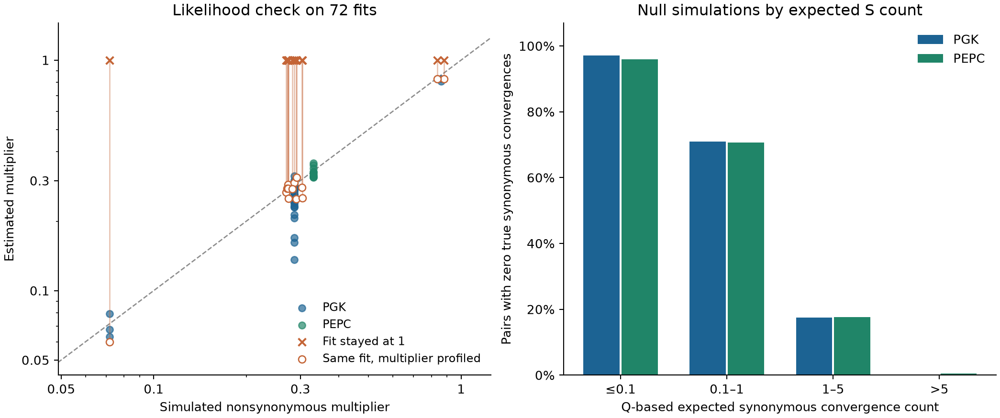

# Sensitivity of pairwise omegaCany2spe on PGK and PEPC templates

The [follow-up recovery check](RECOVERY.md) verifies the automatic refits
on all 14 stalled PGK runs identified in this panel.

The strongest implementation finding is that IQ-TREE sometimes leaves the
ECMK07 nonsynonymous multiplier at its initial value of 1. This occurred in
14 of 60 PGK simulations and in none of 12 PEPC simulations. The same model
can fit all 14 alignments better by moving that single parameter. A separate
problem is the reliability of pair-level ratios when the expected synonymous
count is small. A high ratio also arises under foreground relaxation without
a preferred amino acid.



## Simulation and comparison

CSUBST 1.17.5 at base revision `ed229ac` with the working changes for Q-based
simulation truth and the ECMK07 hybrid model ran under Python 3.12.15,
IQ-TREE 3.1.4, and macOS arm64. The simulations use the bundled PGK
and PEPC input trees, their original lengths scaled as specified below, and
their bundled codon frequencies. PGK foreground branches are eight tips
selected at evenly spaced indices in preorder leaf traversal. PEPC uses the
bundled foreground annotation. The run script lists the full panel.

| Factor | Levels |
| --- | --- |
| PGK and PEPC replicates | PGK seeds 101, 202, 303, 404. PEPC seeds 101, 202, 303 |
| Alignment length | 120, 520, 1,400 codon sites |
| Tree length multiplier | 0.3, 1, 2.5 |
| Site rates | Unit rates, or repeated rates 0, 0.2, 0.8, 3 |
| Background N/S setting | 0.05, 0.2, 0.6 under the simulator's rate-mass convention |
| Foreground changes | 20% of sites with a random preferred amino acid, threefold branch acceleration, or N/S setting 0.8 without a preferred amino acid |
| Fit | `ECMK07_GY0K+F+R4` for 72 alignments, with 16 additional `ECMK07_GY0K+F` refits on the same tips |

The design varies one factor from the reference settings and combines several
factors with directional bias. PEPC repeats the baseline, directional bias,
long branches and rate-mixture conditions. The four mixture rates have equal
weights within a complete cycle. Reusing the shorter source rate file gives
a mean simulated rate of 0.9942 on PGK and 1.0000 on PEPC. Search estimates the parameters
on the known topology from simulated tips. Every default fit finished.
The 205,032 branch-pair replicate rows joined one to one to the simulation
table. The 199,584 rows with numeric expected counts are used for pooled
comparisons. Across the table, `q_omega` uses ratios of summed simulated
means, `true_omega` uses known endpoint counts with those null denominators,
`fixed_null_omega` substitutes the reconstructed O counts, and
`fitted_omega` also substitutes the search EC counts. Each ratio divides
the N rate by the S rate after summing the four contributing count columns.
Pairs sharing branches or sites are dependent, so row proportions are
descriptive.

## The empirical-frequency fit can leave the multiplier at 1

An independent pruning calculation reproduced each of the 72 IQ-TREE
log-likelihoods within 0.000051, using the fitted frequencies, raw tree and
checkpoint rate mixture. With these inputs fixed, a one-dimensional search
over the log multiplier gained **5.44 to 536.02** log-likelihood units on the
14 exact-1 fits, with a median gain of **190.39**. All other fits gained
less than 0.000014. This establishes that the exact-1 fits in this panel had
not maximized the likelihood even conditionally. A value of 1 could still
be appropriate when the likelihood supports it.

For PGK without bias at 520 sites, all eligible pairs pooled over four seeds
gave Q-based ECN/ECS of 30.06/2,123.63. Default search estimated
109.88/1,655.37 (3.66×/0.78×). The expected, realized, reconstructed with the
Q null, and fully fitted pooled omegaC were respectively **1.00, 1.04, 1.08
and 0.23**. Two seeds reached the vicinity of the simulated multiplier
of 0.287 and two stayed at 1. In the four 1,400-site PGK runs, the pooled
ECN/ECS ratios to the Q reference were 1.01 and 0.99.

The frequencies matter. Four of the 14 stalled fits had a zero-frequency
codon, and ten stalled even though all codons were present. Setting a
frequency floor of 0.0001 with IQ-TREE 3.1.4's `--inc-zero-freq --min-freq
0.0001` recovered the optimum in all three stalled cases tried. The healthy
control's fit matched to reported precision. Changing the BFGS variant left
four tested stalled fits at 1. IQ-TREE 2.4.0 also left both tested stalled
alignments at 1. On seed 202, starting at 0.25 or 2.0 with `-optfromgiven`
left the multiplier at that starting value, so a restart alone does not
establish convergence. IQ-TREE sets the starting multiplier in its
[codon model implementation](https://github.com/iqtree/iqtree3/blob/v3.1.4/model/modelcodon.cpp)
and handles the optional frequency floor in
[`Alignment::convfreq`](https://github.com/iqtree/iqtree3/blob/v3.1.4/alignment/alignment.cpp).

| PGK case | Simulated multiplier | Default fit | Frequency-floor fit | Change in log-likelihood | Q ECN / ECS | Default ECN / ECS | Frequency-floor replay ECN / ECS |
| --- | ---: | ---: | ---: | ---: | ---: | ---: | ---: |
| Baseline 202 | 0.287 | 1.000 | 0.285 | +186.92 | 7.51 / 530.91 | 44.06 / 279.70 | 8.41 / 595.33 |
| Baseline 404 | 0.287 | 1.000 | 0.291 | +186.09 | 7.51 / 530.91 | 49.49 / 266.74 | 9.33 / 557.94 |
| Strong constraint 303 | 0.072 | 1.000 | 0.059 | +540.93 | 0.64 / 695.17 | 43.44 / 233.51 | 0.56 / 744.56 |

The `search` version used for this panel rejected the three modified fits because it reconstructs
`+F` from the raw empirical log frequencies. The fitted frequencies are in
`ModelCodon.state_freq` in the IQ-TREE 3.1.4 checkpoint. The replay imports
that vector, verifies its ordering and values by reproducing the IQ-TREE
likelihood within 0.00005, then reconstructs pair counts using
the same endpoint and aggregation code as the default calculation.
IQ-TREE 2.4.0 did not serialize `state_freq` in the two checked checkpoints.
A production change should validate bounded frequency estimates against the
actual fitted vector and verify that the optimizer improved the likelihood
before accepting a refit. The size of the frequency floor and behavior on
other alignments remain to be evaluated.

## Pair support, site rates and foreground model

- **Pair support.** Across background-only conditions on both trees, at
  Q-based expected S counts at or below 0.1, **43,596/45,137 (96.6%)**
  pair-replicates had zero realized S events. At Q-based expected counts
  above 5, this was **10/2,230 (0.45%)**. In the first bin, search returned
  a finite ratio for 43,577 of those 43,596 zero-S rows because it uses
  posterior expected counts. PGK's 120-site background simulations had
  zero realized S in 93.4% of eligible rows versus 63.9% at 1,400 sites.
  In PGK with 20% directional bias, the foreground pooled Q ratio at 120
  sites was 3.10, the realized ratio was 5.46, the reconstructed ratio
  using the Q null was 5.82, and the fitted ratio was 9.08. The realized
  count variability contributes even with the exact null. Exposing count
  support and calibrating uncertainty separately from ranking would make
  these ratios easier to interpret.
- **Rate mixtures.** With the PEPC rate mixture, standard ECN and ECS
  were 0.991× and 0.942× the Q null. Integrating one shared posterior
  rate category per site across the two branches gave 1.031× and 0.973×.
  The pooled omegaC moved from 0.902 to 0.895 (Q reference 1, realized
  0.894). In the PGK rate mixture the same operation moved ECS closer to
  the oracle (0.788× to 0.873×) while increasing ECN error (1.773× to
  2.014×), which includes a poorly optimized multiplier. With uniform
  rates fitted to that PGK mixture, ECS fell to 0.457×. Shared-category
  integration is worth testing with well-optimized fits and exact
  cross-branch posterior dependence. It showed mixed gains here and
  changed observed counts only slightly.
- **Directionality versus relaxation.** PGK foreground relaxation at
  20% of sites with no preferred amino acid raised the pooled Q ratio
  to **2.41**, compared with **3.21** under directional convergence.
  Increasing foreground branch lengths alone left the Q ratio at 1
  when those longer lengths were included in the null. A null that
  models lineage-specific N/S shifts would help distinguish a shared
  preferred destination from increased nonsynonymous opportunity.
- **Root-adjacent pairs.** The current search mask removes 63/1,714
  pairs per PGK run and 139/8,516 per PEPC run, accounting for roughly
  5% and 3% of the corresponding Q-based null counts. Both ECs become
  `NA` even though the joint endpoint engine computes conditional
  predictions. Distinguishing this mask from lack of observed data
  would clarify coverage. Using a fixed root split would require
  validating sensitivity to that split.

The two topology templates and three or four seeds per cell give examples
of error mechanisms. The panel assumes complete tip alignments and compares
endpoint changes. It does not measure sensitivity to alignment gaps,
topology estimation error, or multiple substitutions along a single branch.
The frequency-floor and shared-rate results are research replays. The
production estimator and defaults were not changed by this study.

## Reproduce

Run from the repository root with the editable CSUBST installation. Set
`IQTREE_EXE` and `IQTREE2_EXE` to the IQ-TREE 3.1.4 and 2.4.0 executables
respectively. The drivers write only compact evidence to the report folder
and keep fits and simulated alignments in a temporary directory.

```bash
work="$(mktemp -d)"
scripts=reports/simulate_sensitivity_20261116
out=reports/generated/simulate_sensitivity
export MPLBACKEND=Agg VECLIB_MAXIMUM_THREADS=1 OPENBLAS_NUM_THREADS=1 OMP_NUM_THREADS=1
python "$scripts/run.py" "$work" --iqtree "$IQTREE_EXE" --jobs 9
python "$scripts/summarize.py" "$work" "$out"
python "$scripts/profile_omega.py" "$work" "$out/profile_omega.tsv"
python "$scripts/shared_rates.py" "$work" "$out/shared_rates.tsv"
python "$scripts/plot.py" "$out"

python "$scripts/restart.py" "$work" "$out/freq_floor.tsv" --iqtree "$IQTREE_EXE" \
  --methods freq_floor --reps PGK/baseline-101 PGK/baseline-202 PGK/baseline-404 PGK/strong_constraint-303
python "$scripts/profile_omega.py" "$work" "$out/floor_profile.tsv" --frequency-floor
python "$scripts/shared_rates.py" "$work" "$out/floor_replay.tsv" --frequency-floor
python "$scripts/restart.py" "$work" "$out/restart_pilot.tsv" --iqtree "$IQTREE_EXE" \
  --methods low high --reps PGK/baseline-202
python "$scripts/restart.py" "$work" "$out/bounded_pilot.tsv" --iqtree "$IQTREE_EXE" \
  --methods bounded --reps PGK/baseline-202 PGK/baseline-404 PGK/weak_constraint-202 PGK/strong_constraint-303
python "$scripts/restart.py" "$work" "$out/standard_iqtree2.tsv" --iqtree "$IQTREE2_EXE" \
  --methods standard --reps PGK/baseline-202 PGK/strong_constraint-303
```

- [Pooled counts and ratios](pooled.tsv), [per-seed counts](by_seed.tsv),
  and [S-support strata](by_expected_S.tsv).
- [Fit diagnostics and root mask](fit_diagnostics.tsv),
  [independently profiled multipliers](profile_omega.tsv), and
  [shared-rate comparisons by seed](shared_rates.tsv).
- [Frequency-floor fit outcomes](freq_floor.tsv),
  [likelihood verification](floor_profile.tsv), and
  [frequency-floor pair counts](floor_replay.tsv).
- [Initial-value comparisons](restart_pilot.tsv), [bounded optimizer
  restarts](bounded_pilot.tsv), and [IQ-TREE 2.4.0 checks](standard_iqtree2.tsv).
